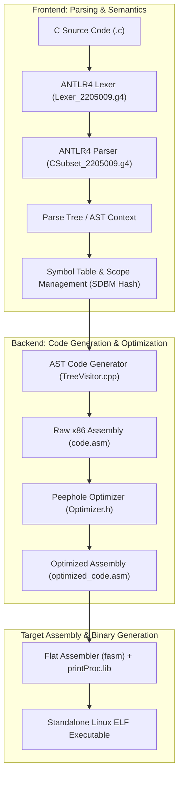

# C-Subset Optimizing Compiler


-green.svg)
-brightgreen.svg)


An optimizing compiler for a comprehensive subset of the C programming language (`C-Subset`), developed for the Compiler Sessional course (**CSE 310**). The compiler implements the full pipeline from source text analysis to executable code generation: lexical and syntactic parsing via ANTLR4, scope-nested symbol table management, intermediate code generation targeting **32-bit x86 assembly**, a multi-pass **peephole optimizer**, and automated assembly linking via the **Flat Assembler (FASM)** to produce standalone Linux ELF executables.

---

## Table of Contents

- [Compiler Architecture & Pipeline](#compiler-architecture--pipeline)
- [Language Features Supported](#language-features-supported)
- [Memory Model & Calling Convention](#memory-model--calling-convention)
- [Peephole Optimization](#peephole-optimization)
- [Project Directory Structure](#project-directory-structure)
- [Prerequisites & Dependencies](#prerequisites--dependencies)
- [Build Instructions](#build-instructions)
- [Usage Guide](#usage-guide)
- [Test Suite & Verification](#test-suite--verification)
- [Course Sessional Milestones](#course-sessional-milestones)
- [License](#license)

---

## Compiler Architecture & Pipeline



### Compilation Stages
1. **Lexical Analysis**: Tokenizes keywords (`int`, `float`, `void`, `if`, `else`, `while`, `for`, `return`, `println`), operators, identifiers, integer/floating literals, and handles comments (`//`, `/* ... */`).
2. **Syntactic & Semantic Analysis**: Validates language grammar rules, types, function prototypes, variable re-declarations, and scope hierarchies.
3. **Symbol Table Resolution**: Employs an SDBM hash table with scoped parent-child relationships to maintain symbol metadata, stack offsets, parameter counts, and global/local classifications.
4. **Intermediate Code Generation**: Translates AST nodes into 32-bit x86 instructions adhering to the standard `cdecl` calling convention.
5. **Peephole Optimization**: Scans intermediate assembly across sliding windows to eliminate redundant memory moves, eliminate dead stack operations, prune identity arithmetic, and merge adjacent labels.
6. **Executable Assembly**: Combines the optimized assembly with the assembly runtime (`printProc.lib`) via FASM to emit a standalone Linux ELF executable.

---

## Language Features Supported

- **Data Types**: `int`, `float`, and `void` return types.
- **Variables & Arrays**:
  - Global and local scalar variable declarations.
  - 1D arrays with static allocation and runtime dynamic index offset calculation (`SHL EAX, 2`).
- **Expressions & Arithmetic**:
  - Binary arithmetic: `+`, `-`, `*`, `/`, `%` (with signed division / remainder via `CDQ` and `IDIV`).
  - Prefix / unary: unary plus, unary minus (`NEG EAX`), boolean NOT (`!`).
  - Increment / Decrement: post-increment (`++`) and post-decrement (`--`) for variables and array elements.
  - Relational operations: `<`, `<=`, `>`, `>=`, `==`, `!=` generating boolean flags (`0` or `1`).
  - Short-circuit / boolean logic: `&&` and `||`.
  - Assignment expressions: `=` with proper l-value address resolution.
- **Control Flow Structures**:
  - `if (condition) statement`
  - `if (condition) statement else statement`
  - `while (condition) statement`
  - `for (init; condition; update) statement`
- **Functions & Recursion**:
  - Function declarations (prototypes) and definitions with multiple typed parameters.
  - Linear and mutual/tree recursion support with isolated stack frames.
  - Caller stack cleanup post-invocation.
- **Standard Output**:
  - Built-in `println(expr)` printing signed 32-bit integers to standard output using native Linux syscalls (`int 0x80`, `sys_write`).

---

## Memory Model & Calling Convention

The compiler targets **32-bit x86 architecture** adhering to the standard `cdecl` calling convention:

### Register Assignments
| Register | Primary Responsibility |
| :--- | :--- |
| `EAX` | Expression evaluation accumulator, function return values, arithmetic destination |
| `EBX` | Base address for array indexing, second operand for binary operations, syscall codes |
| `EDX` | High 32 bits for division (`IDIV`), remainder destination |
| `EBP` | Base Pointer establishing the current activation record (stack frame) |
| `ESP` | Stack Pointer tracking the active stack boundary |

### Stack Frame Layout
```
                     +-----------------------+
                     |  Argument N           |  [EBP + 8 + 4*(N-1)]
                     |  ...                  |
                     |  Argument 1           |  [EBP + 8]
                     +-----------------------+
                     |  Return Address (EIP) |  [EBP + 4]
                     +-----------------------+
       EBP Pointer ->|  Saved Old EBP        |  [EBP + 0]
                     +-----------------------+
                     |  Local Variable 1     |  [EBP - 4]
                     |  Local Variable 2     |  [EBP - 8]
                     |  ...                  |
       ESP Pointer ->|  Local Variable M     |  [EBP - 4*M]
                     +-----------------------+
```

---

## Peephole Optimization

The peephole optimizer (`src/compiler/Optimizer.h` / `2205009_Optimizer.h`) performs multi-pass iterative sliding-window reductions:

1. **Redundant Stack Operations**:
   ```assembly
   PUSH EAX     --> (Eliminated)
   POP EAX
   ```
2. **Redundant Register Moves**:
   ```assembly
   MOV EAX, EBX --> MOV EAX, EBX
   MOV EBX, EAX --> (Eliminated)
   ```
3. **Identity Algebraic Simplifications**:
   - `ADD EAX, 0` / `SUB EAX, 0` $\rightarrow$ Eliminated
   - `IMUL EAX, 1` $\rightarrow$ Eliminated
4. **Consecutive Label Coalescing**:
   - Detects consecutive redundant jump targets (`L1:` immediately followed by `L2:`) and globally replaces references to `L2` with `L1`.

---

## Project Directory Structure

```
C-Subset-Compiler/
├── Makefile                       # Unified build: make, make test, make clean, make grammar
├── compile.sh                     # Automated CLI driver: .c -> Assembly -> ELF binary
├── LICENSE                        # MIT License
├── README.md                      # Complete project documentation
├── bin/                           # Compiled binaries (csubset, csubset-analyzer)
├── lib/                           # Runtimes & ANTLR parser tools
│   ├── printProc.lib              # 32-bit x86 assembly I/O procedure for println
│   └── antlr-4.13.2-complete.jar  # Complete ANTLR 4.13.2 toolchain jar
├── src/
│   ├── compiler/                  # Core Code-Generating Compiler
│   │   ├── main.cpp               # Driver entrypoint
│   │   ├── TreeVisitor.h/.cpp     # AST traversal & x86 assembly code generator
│   │   ├── SymbolInfo.h           # Symbol table entry descriptor
│   │   ├── ScopeTable.h           # Scoped hash table with SDBM algorithm
│   │   ├── SymbolTable.h          # Multi-scope management
│   │   ├── Optimizer.h            # Peephole assembly optimization passes
│   │   ├── CSubset_2205009.g4     # Parser grammar specification
│   │   ├── Lexer_2205009.g4       # Lexer grammar specification
│   │   └── CSubset_2205009*.cpp   # Pre-generated ANTLR C++ runtime files
│   └── analyzer/                  # Phase 3 Syntax & Semantic Analyzer
│       ├── main.cpp               # Analyzer driver
│       └── TreeVisitor.h/.cpp     # Parse tree logger & semantic error checker
├── tests/
│   ├── verify.sh                  # Comprehensive test verification runner
│   ├── test_suite/                # 22 official corner & benchmark test programs
│   ├── sample_cases/              # 17 extended unit tests with expected outputs
│   └── semantic_samples/          # Syntax/semantic analysis test inputs and reference logs
├── docs/                          # Specifications & architecture tutorials
│   ├── architecture_and_presentation.md
│   ├── CSE_310_ICG_Specification.pdf
│   ├── Antlr_Syntax_Specification.pdf
│   └── Grammar_Rules.pdf
└── stages/                        # Historical sessional course milestones
    ├── 1-symbol-table/            # Phase 1: Symbol Table engine
    ├── 2-lexical-analyzer/        # Phase 2: Flex lexer
    ├── 3-syntax-semantic-analyzer/# Phase 3: ANTLR AST semantic analyzer
    └── 4-intermediate-code-generator/ # Phase 4: Intermediate code generator
```

---

## Prerequisites & Dependencies

### Operating System
- **Linux** (x86_64 or i386) — tested on Ubuntu 20.04, 22.04, and 24.04.

### Required Packages
Install the required C++ compiler, Flat Assembler, and Java runtime (if rebuilding grammars):

```bash
sudo apt-get update
sudo apt-get install -y build-essential g++ fasm libantlr4-runtime-dev default-jre
```

---

## Build Instructions

### 1. Build All Binaries
To build both the code-generating compiler (`bin/csubset`) and the semantic analyzer (`bin/csubset-analyzer`):
```bash
make
```

### 2. Run All Automated Tests
To build and execute the full 39-test verification suite:
```bash
make test
```

### 3. Rebuild ANTLR Grammars
If you modify `.g4` grammars in `src/compiler/` or `src/analyzer/`:
```bash
make grammar
```

### 4. Clean Build Artifacts
```bash
make clean
```

---

## Usage Guide

### Using the Automated Driver (`compile.sh`)

The `compile.sh` script automates the complete pipeline from C code to a runnable ELF binary:

```bash
# 1. Compile a C program to an executable with the same name:
./compile.sh tests/test_suite/test1_i.c

# 2. Specify a custom executable output name:
./compile.sh tests/test_suite/func.c -o my_func_binary

# 3. Compile and execute immediately:
./compile.sh tests/test_suite/recursion1_i.c --run

# 4. Generate only x86 assembly without assembling:
./compile.sh tests/test_suite/loop.c --asm-only

# 5. Disable peephole optimization (use raw code.asm):
./compile.sh tests/test_suite/exp.c --no-opt --run
```

### Running the Compiler Directly

```bash
# Generate raw code.asm and optimized_code.asm:
./bin/csubset tests/test_suite/test1_i.c

# Assemble into executable using FASM:
INCLUDE="lib" fasm optimized_code.asm test1.elf
chmod +x test1.elf

# Run executable:
./test1.elf
```

### Running the Syntax & Semantic Analyzer

```bash
./bin/csubset-analyzer tests/semantic_samples/input1.txt
# Inspect results in log.txt and error.txt:
cat log.txt
cat error.txt
```

---

## Test Suite & Verification

The compiler features an automated test runner (`tests/verify.sh`) verifying **39 comprehensive test cases** against expected execution outputs:

| Benchmark / Test Category | Test Files | Tested Features | Status |
| :--- | :--- | :--- | :--- |
| **Arithmetic & Operators** | `test1_i.c`, `sample2_arithmetic.c`, `test_t2_addop.c`, `test_t3_mulop.c`, `test_t9_negative_arith.c` | Precedence, sign inversion, modulo arithmetic, signed division | **PASSED** |
| **Logic & Relational** | `test7_i.c`, `sample3_relational.c`, `sample4_logical.c`, `test_t5_relop.c`, `test_t6_logicop.c` | Relational jumps, complex boolean compound conditions | **PASSED** |
| **Conditionals & Branching** | `test2_i.c`, `corner1_i.c` to `corner4_i.c` | Nested `if` / `else if` / `else` chaining | **PASSED** |
| **Loops & Iteration** | `test3_i.c`, `loop.c`, `corner5_i.c` to `corner7_i.c` | `for` loops, `while` loops, post-decrements in condition | **PASSED** |
| **Variables & Scope** | `sample1_basic.c`, `test_t1_multi_globals.c`, `test_t10_global_local_mix.c` | Global vs stack-allocated local variable isolation | **PASSED** |
| **Arrays & Indexing** | `test6_i.c`, `exp.c`, `corner8_i.c`, `corner9_i.c` | Global and local 1D arrays, index offset arithmetic, array assignments | **PASSED** |
| **Functions & Parameters** | `func.c`, `test4_i.c`, `test5_i.c` | Multi-argument calls, parameter evaluation order (`cdecl`), return values | **PASSED** |
| **Recursion** | `recursion1_i.c`, `recursion2_i.c`, `corner10_i.c` | Mutual/tree recursion and deep activation frames | **PASSED** |

Run the test suite anytime:
```bash
./tests/verify.sh
```

---

## Course Sessional Milestones

The `stages/` folder documents the progression of the compiler through each course assignment:
- **Phase 1: Symbol Table** (`stages/1-symbol-table/`): Implements hashed scope tables, symbol lookup, insertion, and nested scope management.
- **Phase 2: Lexical Analyzer** (`stages/2-lexical-analyzer/`): Token recognition using Flex with error classification and symbol table logging.
- **Phase 3: Syntax & Semantic Analyzer** (`stages/3-syntax-semantic-analyzer/`): ANTLR4 grammar implementation with parse tree rule logging, type validation, and semantic error reporting.
- **Phase 4: Intermediate Code Generator** (`stages/4-intermediate-code-generator/`): 32-bit x86 code emission, activation records, and target executable linking.

---

## License

This project is licensed under the [MIT License](LICENSE).
